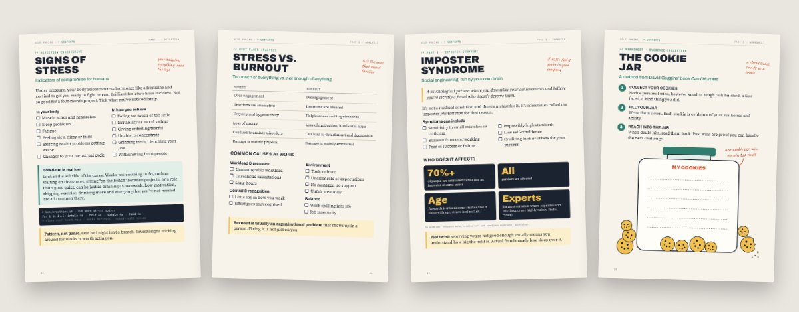
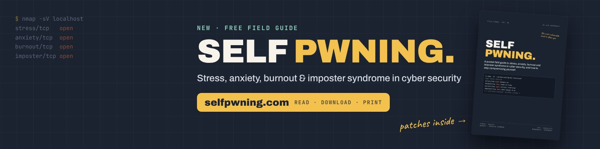

## Intro

I wish I'd had this guide before I wrote it! 😂

What started as a talk on imposter syndrome turned into a full-blown discussion on mental health in cyber security. It's taken me to 7 cities across 5 different countries, and somewhere along the way it became the thing I'm most proud of doing in this industry.

So I've finally done something with it. **Self Pwning** is a [free pocket field guide to stress, anxiety, burnout and imposter syndrome in cyber security](https://selfpwning.com). It's live now at **[selfpwning.com](https://selfpwning.com)**.

## How We Got Here

The first time I gave the talk was at Elbsides. I was nervous, I wasn't sure anyone would care, and I half expected a room full of people checking their phones.

What actually happened is the bit I didn't see coming. After the talk, people came up to me. Not to ask about tooling or techniques, but to say a quiet "thank you", or "I'm glad I'm not the only one". That kept happening, city after city.

Anyone who's read my [OSCP story](/posts/My-OSCP-Story/) knows I've had my own run-in with burnout, so I get it. And I think that's why it resonates: in cyber we're brilliant at spotting weaknesses in systems, and terrible at spotting them in ourselves.

## Why It Took So Long

Here's the ironic part. I've wanted to turn the talk into something more useful since that very first one. Something people could take away, keep on their phone, or leave on a desk for a colleague who's struggling.

What stopped me? My own self-doubt. Who am I to write a guide? Will anyone actually read it? Surely someone else has done this better?

Yes, the imposter syndrome speaker had imposter syndrome. 😬

Eventually I realised I was doing the exact thing the talk tells people not to do. So it was time to nip that in the bud.

## What's in the Guide?

It's 20 pages, A5, and written in the language we already use every day: threat intel, indicators of compromise, root cause analysis and patches. The cover even starts with an nmap scan of your own wellbeing:

```
$ nmap -sV --script=wellbeing localhost
stress/tcp     open   always-on
anxiety/tcp    open   what-if-loop
burnout/tcp    open   chronic-overtime
imposter/tcp   open   self-doubt v2.0
# 4 services exposed. patches inside ↓
```

It's split into three parts:

- **Stress & anxiety:** why cyber is exposed (rated by severity, like a report finding 😜), the signs to look out for, a grounding exercise for when anxiety spirals, and how to spot your triggers.
- **Burnout:** how it's different from stress, why it's usually an organisational problem and not a personal failing, and a "go-bag" to help you recover.
- **Imposter syndrome:** what it looks like in offence, defence and GRC, the BS List for challenging those thoughts, and the Cookie Jar for collecting evidence that you're better than you think.

{: w="1200" h="470" }
_A few pages from the guide_

There are checklists and worksheets to fill in, plus a page of helplines at the back for when tips aren't enough.

One important thing: I'm a security person, not a mental health professional. The guide isn't a substitute for professional help. If you're struggling, please talk to your GP, a doctor or a therapist.

## Get Your Copy

It's completely free. Head to **[selfpwning.com](https://selfpwning.com)** where you can:

- Read it online
- Download the PDF
- Print it as a booklet (A4, double-sided, fold in half and staple)

It's licensed under CC BY-NC-ND 4.0, so share it with your team, print it for the office, or send it to that one colleague who always says they're "fine". 🙂

If you'd like to adapt or translate it, have feedback, or want to chat about the talk, drop me a line at [hello@selfpwning.com](mailto:hello@selfpwning.com).

## Bonus: New LinkedIn Banner

Of course, I couldn't launch it without giving my LinkedIn profile a refresh too:

{: w="1584" h="396" }
_Same look as the guide, nmap scan and all_

## What is Next?

This is Vol. 01, and it won't be the last. I'll keep updating it as I learn more and as people send feedback, and the latest version will always live at selfpwning.com.

If it helps one person log off on time tonight, it's done its job.

## TL;DR

- My talk on mental health in cyber security is now a free 20-page field guide called **Self Pwning**.
- It covers stress, anxiety, burnout and imposter syndrome, written in security language.
- Read, download or print it at **[selfpwning.com](https://selfpwning.com)**.
- Self-doubt nearly stopped me making it. Don't let it stop you doing your thing.

Don't self pwn. Patch. Rest. Repeat.
